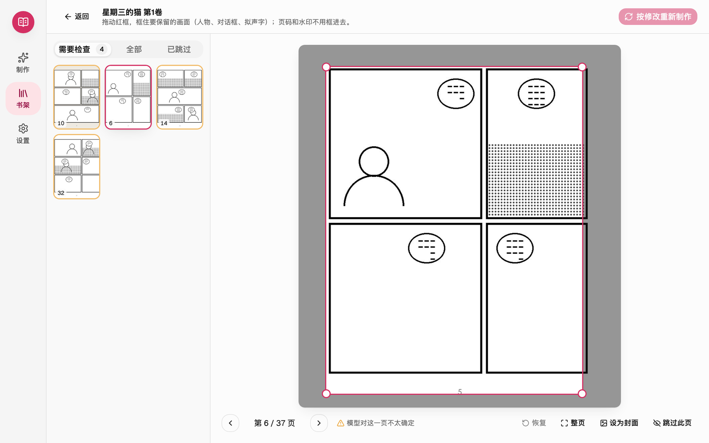

  

<h1 align="center">MangaBox 漫画成书</h1>

  把一个装着漫画图片的文件夹，做成适合电子书阅读器的 EPUB / CBZ。 
  自动拆页、裁掉白边、放大到阅读器分辨率并居中。免费，双击就能用。

  <a href="https://github.com/x956606865/mangabox/releases/latest"><b>下载最新版</b></a> ·
  <a href="https://x956606865.github.io/mangabox/">官网</a> ·
  <a href="https://github.com/x956606865/mangabox/issues/new/choose">反馈问题</a>

  

## 能做什么

- **自动拆页**：左右两页拼在一起的横图会自动拆开，按日漫习惯先右后左。
- **裁掉白边**：模型找出每页正文（包括出框的人物、对话框和拟声字）的范围，页码和外围水印不会影响裁切。
- **放大与居中**：用 MangaJaNai 放大模型把画面放大到阅读器分辨率，全书统一大小，翻页时不会忽大忽小。
- **检查并修正**：模型不太确定的页排在前面，拖动红框调整后一键重新制作。
- **整套制作**：一个文件夹里按卷分好的多卷漫画，确认卷号后每卷做成一本，系列名和卷号写进电子书。
- **安全**：原图不会被修改，也不会上传到网络。

支持的阅读器：BOOX Leaf 5、Tab Mini C、Tab Ultra C、Tab X C，Kindle Paperwhite。

## 截图

| 开始 | 制作中 |
| --- | --- |
|  |  |
| **做好了** | **检查并修正** |
|  |  |
| **整套制作** | **书架（深色模式）** |
|  |  |

截图中的漫画是程序生成的示意图。

## 下载与安装

到 [Releases](https://github.com/x956606865/mangabox/releases/latest) 下载对应系统的安装包：

| 系统 | 文件 | 要求 |
| --- | --- | --- |
| macOS | `MangaBox-版本-macos-arm64.dmg` | Apple 芯片（M1 及更新），macOS 12 以上 |
| Windows | `MangaBox-版本-windows-x64.zip` | 64 位 Windows 10 / 11 |

### macOS 第一次打开

MangaBox 是免费软件，没有向苹果付费做“公证”，第一次打开时系统会提示无法验证开发者：

1. 打开 dmg，把 MangaBox 拖到“应用程序”。
2. 双击 MangaBox，看到提示后点“完成”。
3. 打开“系统设置 → 隐私与安全性”，在页面下方点“仍要打开”，输入密码确认。

以后就可以像普通软件一样直接打开。

### Windows

1. 右键 zip →“全部解压缩”（不要在压缩包里直接运行）。
2. 打开解压出的 MangaBox 文件夹，双击“启动 MangaBox.bat”。
3. 如果出现“Windows 已保护你的电脑”，点“更多信息”→“仍要运行”。

有 NVIDIA 显卡的电脑，可以在“设置 → 加速”里一键开启 GPU 加速（需要下载约 2.6 GB）。

## 常见问题

**会上传我的漫画吗？** 不会。所有处理都在你的电脑上完成。联网只用于检查新版本（可在设置里关闭）和你主动安装的 GPU 加速。

**做好的书在哪里？** macOS 在“文稿/MangaBox”，Windows 在“文档\MangaBox”，也可以在“设置”里一键打开。

**支持压缩包吗？** 目前需要先解压成文件夹。

**怎么更新？** 有新版本时 MangaBox 会提示，在“设置 → 关于”里可以直接下载新安装包。

**遇到问题？** 请到 [Issues](https://github.com/x956606865/mangabox/issues/new/choose) 反馈，最好附上日志：macOS 在 `~/Library/Logs/MangaBox.log`，Windows 在“文档\MangaBox\client.log”。

## 许可与致谢

MangaBox 免费提供，本仓库用于发布安装包和收集反馈。

随安装包附带的放大模型 [MangaJaNai / IllustrationJaNai](https://github.com/the-database/MangaJaNai)（作者 the-database）采用 **CC BY-NC 4.0**，只能用于非商业用途。其他开源组件的许可见安装包内的《第三方许可》。
