

  

<h1 align="center">ACGBox 次元匣</h1>

  原 MangaBox。把装着漫画图片的文件夹做成适合电子书阅读器的 EPUB / CBZ，书架管理漫画收藏； 
  番剧区按作品管理番剧、追番表看每天更新，连上自己的 Plex 和 AutoBangumi 后订阅、下载进度、整理元数据、入库一站搞定； 
  成书放进自己的百度网盘，多台电脑和安卓手机同步书架。免费，双击就能用。

  <a href="https://github.com/x956606865/mangabox/releases/latest"><b>下载最新版</b></a> ·
  <a href="https://mangabox.moukeer.com/">官网</a> ·
  <a href="https://github.com/x956606865/mangabox/issues/new/choose">反馈问题</a>

  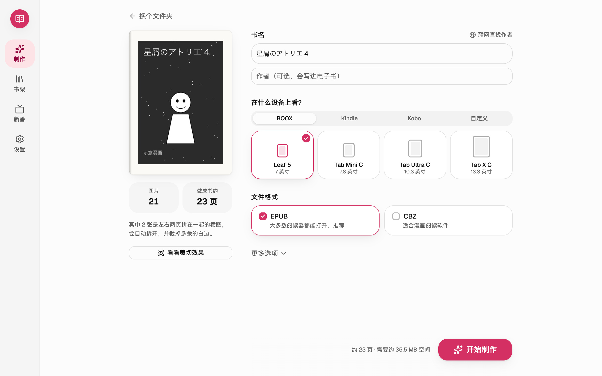

## 能做什么

### 做书

- **自动拆页**：左右两页拼在一起的横图会自动拆开；日漫先右后左，国漫、韩漫、欧美漫画可以选从左往右。
- **裁掉白边**：模型找出每页正文（包括出框的人物、对话框和拟声字）的范围，页码和外围水印不会影响裁切。
- **放大与居中**：用 MangaJaNai 放大模型把画面放大到阅读器分辨率，全书统一大小，翻页时不会忽大忽小。
- **自动认书名**：从文件夹名认出书名、作者和卷号，去掉下载站标记；也可以联网到 Bangumi 查正式书名和作者。
- **检查与前后对比**：做好后按阅读器屏幕的样子翻看；模型不太确定的页排在前面，拖动红框调整，一键重新制作。原图和成品可以叠在一起，拖动分界线看裁掉了什么。
- **整套与连载**：按卷分好的多卷漫画每卷做成一本；按话发布的资源（单话合集，或前面是卷、后面是一话一话）做成一本连载，按话一直往下排，新出的话随时补上，导出、复制到阅读器时可以只选其中几话。
- **扫描件画质修正与去水印**：纸面发黄、歪斜的页自动修正，正常的数字版不会被改动；每页同一位置的网站水印可以去掉。
- **为墨水屏优化**：可选锐化和 16 级灰抖动，体积小四成多，附带设备测试页。
- **EPUB 也能重做**：手里只有低清晰度的 EPUB 时，可以拆出来重新放大、裁边，做成适合阅读器的书（有版权保护的打不开，会直接提示）。
- **下载完成后自动制作**：指定下载文件夹后，书架上做过的作品出了新卷，下载完就按上次的设置自动做成书。
- **直接打开压缩包**：支持 zip / cbz / rar / 7z，把文件夹或压缩包拖进窗口就能开始。

### 收藏

- **书架与分类书架**：整套叠成一套、每个阅读器一个版本；标“想读 / 在读 / 读完 / 搁置”，建“通勤”“已收齐”这样的分类书架。还没有书的作品也能按名字加进书架。
- **已有的书也能登记**：导入现成的电子书、读取 Calibre 书库、扫描文件夹或 NAS，商店里买的也能登记，文件都留在原处；按文件夹登记时，作品文件夹归成一部作品、分类文件夹建成书架。副本可以标语言，同一卷的中文版和日文版不算重复。
- **作品主页与详情**：Bangumi 上的封面、评分、作者、出版社、标签和简介；各卷的出版时间线，有哪几卷、缺哪几卷一眼看出；详情里按卷列出每一份在本机、网盘、别的设备上的位置和大小。
- **每卷已读**：在各卷时间线上标已读，也能把第 1 卷到这一卷一起标上；已完结的作品全部读完会自动改成“读完”。
- **追更与新刊日历**：出了新卷在书架上提醒，一键筛出有新卷、还没对应的作品；按月历看书架上的作品哪天出下一卷。
- **我的评分**：按画风、剧情、人物塑造、主观喜爱等维度打分（10 分制，0.5 一档），不适用的维度跳过，按权重算出最终评分，再写一篇短评。评分方案可以在设置里修改、新建。
- **新番原作**：当季和下季动画里有哪些漫画原作，有介绍、评分和首播日期，一键加入书架。
- **收藏统计**：收了多少作品、卷和页，作者、出版社、标签的分布，还能生成年度回顾图片。

### 番剧

- **番剧库**：同一部作品的各季放在一起，资料来自 Bangumi，填了 TMDB Key 时补上剧照和单集简介；记每集看没看，按加入、最近观看或发行时间排序。
- **追番表**：按星期列出当季放送，在追的番显示更新到第几集、几集没看；只显示当季在播的。
- **按字幕组订阅**：在追番表上点一部番，看各字幕组最近发布了哪几集，选一个交给你的 AutoBangumi 订阅，番剧同时加进番剧库。
- **订阅管理**：AutoBangumi 的订阅按开播的年份和季度分组，改番名、季、集数偏移，过季的一键整季停用；已经下好的文件不会动。
- **下载动态**：RSS 新出了哪些集、qBittorrent 下到多少、哪一集卡住了；每集从下载、整理到 Plex 入库走到了哪一步。
- **整理元数据**：新下完的集自动写好 Kodi 格式的 NFO、海报、背景图和剧照（和 TMM 的产物一样），只补缺的，可以撤销。
- **Plex 同步**：观看记录和 Plex 双向同步，Plex 的资料库自动建成番剧书架；新集整理好后让 Plex 只刷新这部番，刷新完自动拉回。
- **本地文件与播放**：认出番剧文件夹里的每一集，按规范重命名；用 IINA、mpv 等外部播放器播放，只在 Plex 上有的集直接打开 Plex 播放。

ACGBox 不内置下载，也不提供任何资源：订阅和下载由你自己的 AutoBangumi 和 qBittorrent 完成，按字幕组订阅时只读取蜜柑计划公开的番剧页面来列出字幕组。

### 网盘与多设备

- **百度网盘**：做好的书上传到自己的百度网盘、放进你选的文件夹，也可以做完自动上传；阅读器（如 BOOX）直接从网盘读，电脑上不用全部留着。使用你自己在百度网盘开放平台注册的应用扫码授权，不需要密码。
- **登记与整理网盘里的书**：网盘里已有的电子书扫描后登记到书架；一部作品散在各处的文件归拢到一起，重复的卷挑一份留下，按书架分好文件夹。
- **高清化后替换**：网盘里画质差的一卷（EPUB / CBZ），一键下载下来重新做成书，再覆盖网盘上的原文件；做过的会记下来，不会反复做。
- **本机瘦身**：已经放进网盘的书可以释放本机空间，需要时再下载回来；不常改的书可以清理成品页和原图。删掉的都进废纸篓。
- **多台电脑同步书架**：阅读状态、分类书架、已读、评分和作品资料，通过共享文件夹或 WebDAV（坚果云、NAS 等）在几台电脑之间同步。
- **安卓手机管理端**：在手机上看书架和作品资料、改阅读状态、标已读、打分、按名字添加想读的作品，和电脑同步。只管理，不在手机上看漫画。

原图不会被修改；只有你选择上传的成书会放进你自己的网盘。

支持的阅读器：BOOX Leaf 5 / Tab Mini C / Tab Ultra C / Tab X C，Kindle / Paperwhite / Colorsoft / Scribe，Kobo Clara / Libra / Sage / Elipsa 2E；其他阅读器可以自定义屏幕分辨率。

## 截图

| 开始 | 制作中 |
| --- | --- |
| 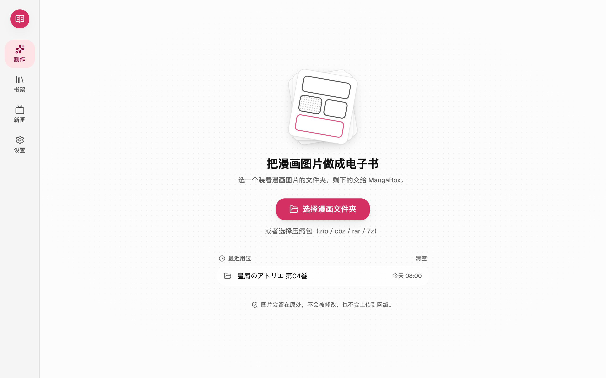 | 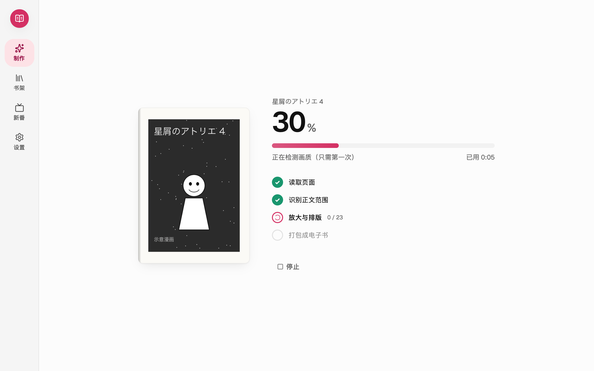 |
| **检查并修正** | **做书前后对比** |
| 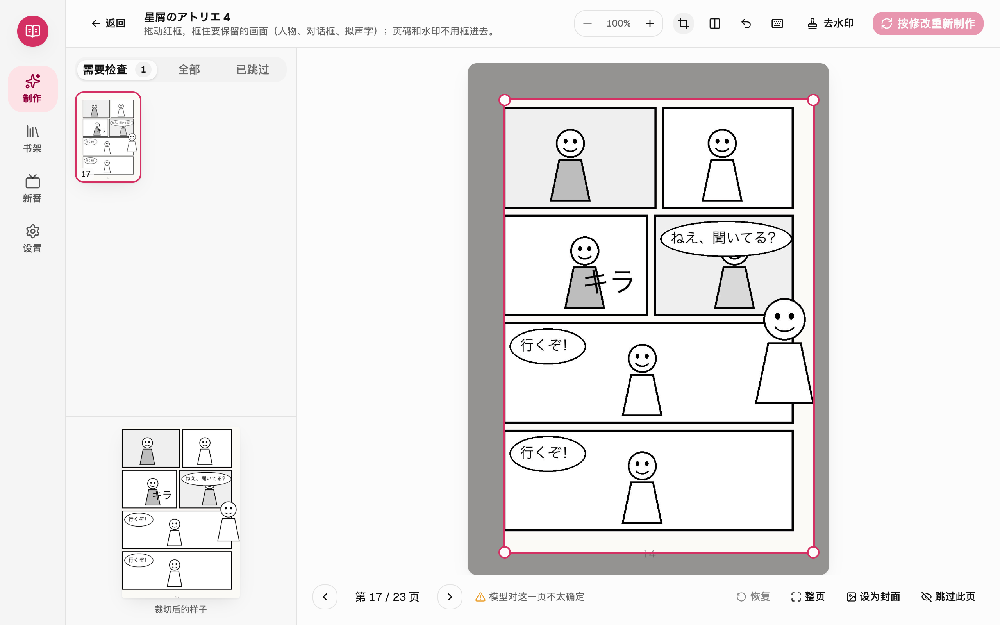 | 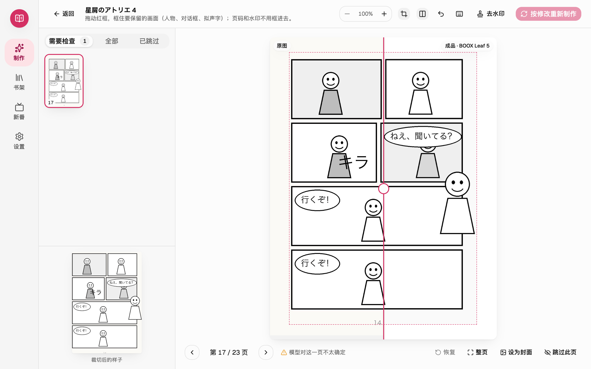 |
| **书架** | **作品主页** |
| 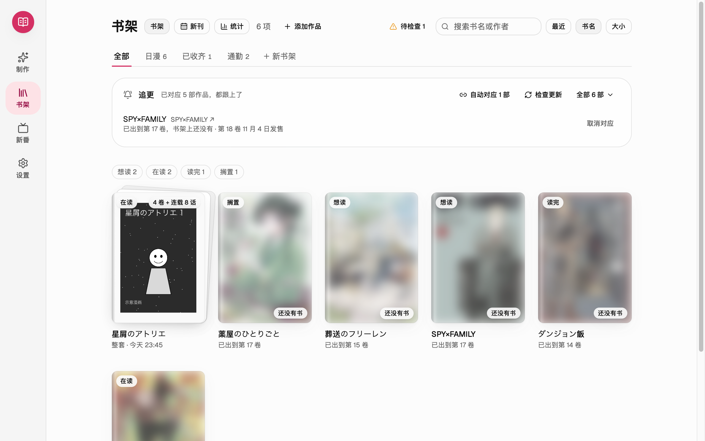 | 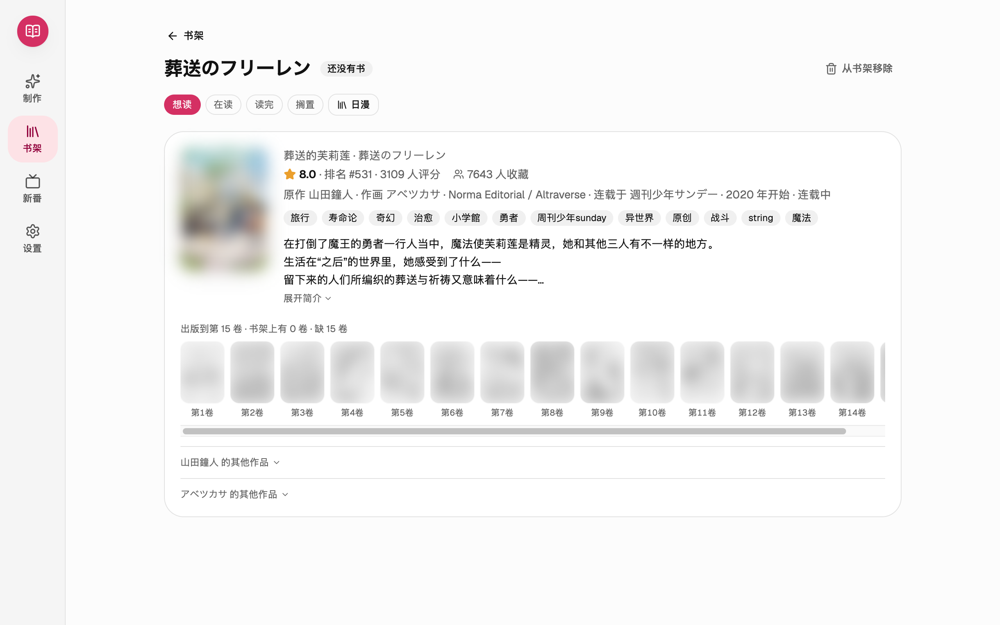 |
| **新刊日历** | **新番原作** |
| 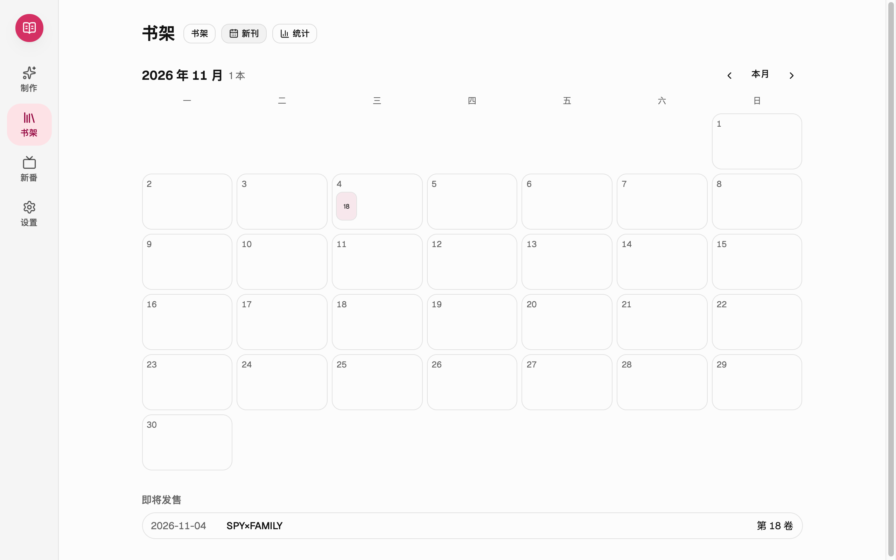 | 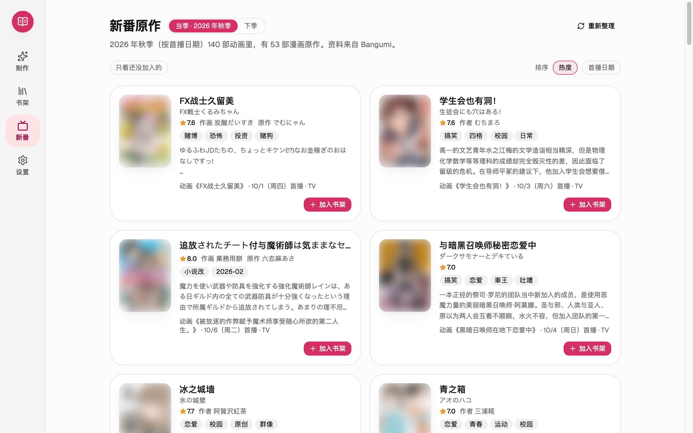 |
| **收藏统计** | **深色模式** |
| 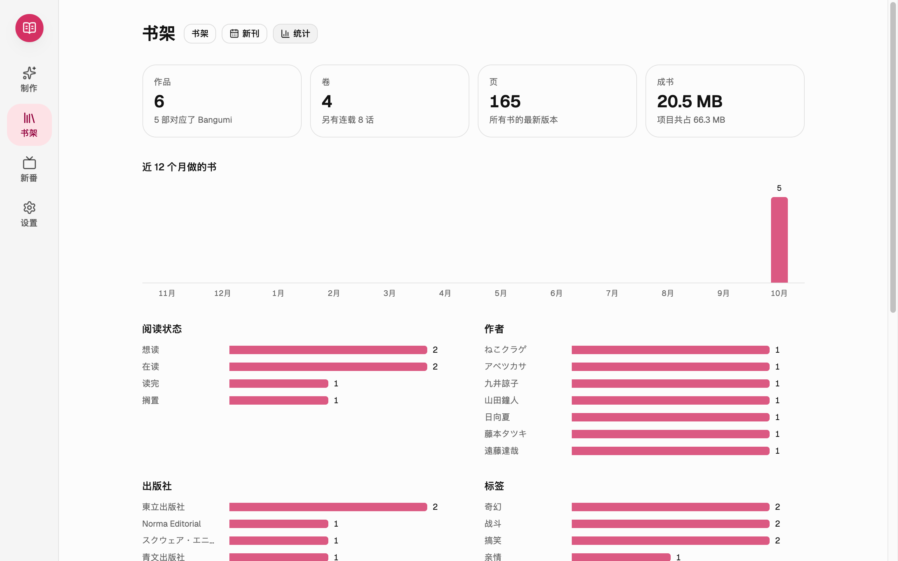 | 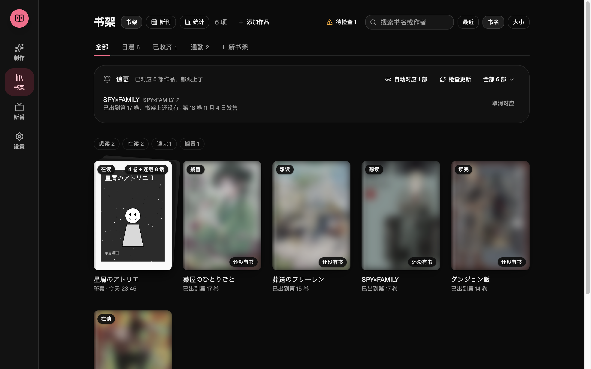 |

番剧区的截图之后补上。截图中“星屑のアトリエ”是程序生成的示意漫画；其他作品的资料来自 Bangumi，封面已模糊处理。

## 下载与安装

到 [Releases](https://github.com/x956606865/mangabox/releases/latest) 下载对应系统的安装包（改名后安装包和程序文件仍叫 MangaBox）：

| 系统 | 文件 | 要求 |
| --- | --- | --- |
| macOS | `MangaBox-版本-macos-arm64.dmg` | Apple 芯片（M1 及更新），macOS 12 以上 |
| Windows | `MangaBox-版本-windows-x64.zip` | 64 位 Windows 10 / 11 |
| 安卓手机（管理端） | `MangaBox-版本-android.apk` | Android 8.0 以上；用手机浏览器下载后安装，按提示允许“安装未知应用” |

### macOS 第一次打开

ACGBox 是免费软件，没有向苹果付费做“公证”，第一次打开时系统会提示无法验证开发者：

1. 打开 dmg，把 MangaBox 拖到“应用程序”。
2. 双击 MangaBox，看到提示后点“完成”。
3. 打开“系统设置 → 隐私与安全性”，在页面下方点“仍要打开”，输入密码确认。

以后就可以像普通软件一样直接打开。

### Windows

1. 右键 zip →“全部解压缩”（不要在压缩包里直接运行）。
2. 打开解压出的 MangaBox 文件夹，双击“启动 MangaBox.bat”。
3. 如果出现“Windows 已保护你的电脑”，点“更多信息”→“仍要运行”。

macOS 用 Apple 芯片加速；Windows 有显卡（NVIDIA / AMD / Intel）时自动用显卡加速，不需要另外下载，用不了时改用 CPU（慢一些，效果一样）。

## 常见问题

**会上传我的漫画吗？** 不会。所有处理都在你的电脑上完成，原图不会离开你的电脑。只在这些时候联网：检查新版本和下载模型（GitHub）；查找作者、追更、看作品主页、番剧资料时向 Bangumi 查询（只发送作品名或条目编号）；你填了 TMDB Key 时取番剧剧照和简介；你连接了 Plex、AutoBangumi 时访问你自己的服务器；按字幕组订阅时读取蜜柑计划公开的番剧页面；你设置了 WebDAV 同步时，把书架记录同步到你自己的 WebDAV；以及你主动连接百度网盘后，按你的操作上传、下载、整理你网盘里的电子书。详见[隐私政策](https://mangabox.moukeer.com/privacy.html)。

**多台电脑、手机怎么同步？** 在每台设备的设置里选同一个同步文件夹（iCloud、坚果云等同步盘里的文件夹都可以），或填同一个 WebDAV 地址。同步的是书架记录（作品、阅读状态、分类、已读、评分）和作品资料、封面，不同步电子书本身；电子书可以放在网盘里共用。

**做好的书在哪里？** macOS 在“文稿/MangaBox”，Windows 在“文档\MangaBox”，也可以在“设置”里一键打开。

**支持压缩包吗？** 支持 zip / cbz / rar / 7z，可以直接选择或拖进窗口；有密码的压缩包需要先解压。

**MangaBox 怎么变成了 ACGBox？** 加入番剧区以后，软件不再只管漫画，名字改成了 ACGBox 次元匣。只是改名：老版本照常收到更新，做好的书、书架和设置都不变；数据文件夹、安装后的程序文件仍然叫 MangaBox。

**怎么更新？** 有新版本时 ACGBox 会提示，在“设置 → 关于”点“更新并重启”，会自动下载、安装并重新打开（0.5.0 起）。

**遇到问题？** 请到 [Issues](https://github.com/x956606865/mangabox/issues/new/choose) 反馈，最好附上诊断信息：在“设置 → 遇到问题”点“导出诊断信息”，会在“下载”文件夹生成一个压缩包（不含漫画图片）。

## 隐私与条款

- [隐私政策](https://mangabox.moukeer.com/privacy.html)
- [服务条款](https://mangabox.moukeer.com/terms.html)

## 许可与致谢

ACGBox 次元匣免费提供，本仓库用于发布安装包和收集反馈。

随安装包附带的放大模型 [MangaJaNai / IllustrationJaNai](https://github.com/the-database/MangaJaNai)（作者 the-database）采用 **CC BY-NC 4.0**，只能用于非商业用途。其他开源组件的许可见安装包内的《第三方许可》。
