

  

<h1 align="center">MangaBox 漫画成书</h1>

  把一个装着漫画图片的文件夹，做成适合电子书阅读器的 EPUB / CBZ。 
  自动拆页、裁掉白边、放大到阅读器分辨率并居中；书架管理收藏，追更、新刊日历、新番原作。免费，双击就能用。

  <a href="https://github.com/x956606865/mangabox/releases/latest"><b>下载最新版</b></a> ·
  <a href="https://mangabox.moukeer.com/">官网</a> ·
  <a href="https://github.com/x956606865/mangabox/issues/new/choose">反馈问题</a>

  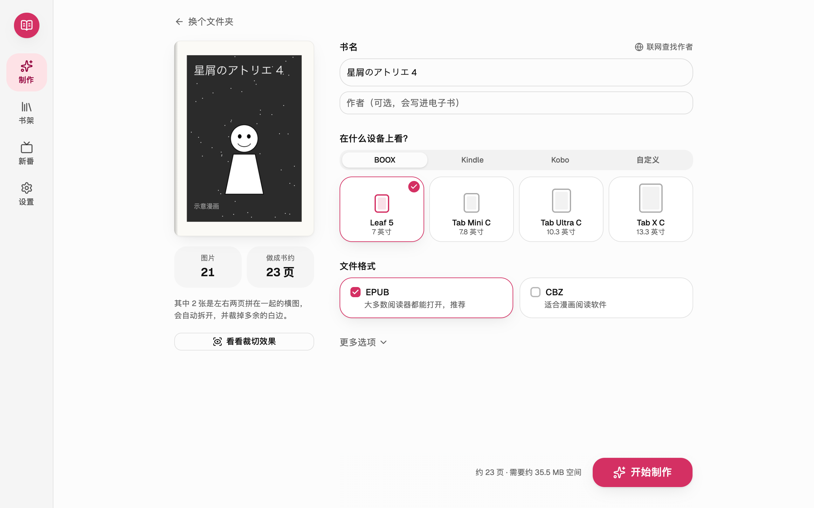

## 能做什么

### 做书

- **自动拆页**：左右两页拼在一起的横图会自动拆开；日漫先右后左，国漫、韩漫、欧美漫画可以选从左往右。
- **裁掉白边**：模型找出每页正文（包括出框的人物、对话框和拟声字）的范围，页码和外围水印不会影响裁切。
- **放大与居中**：用 MangaJaNai 放大模型把画面放大到阅读器分辨率，全书统一大小，翻页时不会忽大忽小。
- **自动认书名**：从文件夹名认出书名、作者和卷号，去掉下载站标记；也可以联网到 Bangumi 查正式书名和作者。
- **检查与前后对比**：做好后按阅读器屏幕的样子翻看；模型不太确定的页排在前面，拖动红框调整，一键重新制作。原图和成品可以叠在一起，拖动分界线看裁掉了什么。
- **整套与连载**：按卷分好的多卷漫画每卷做成一本；按话发布的资源（单话合集，或前面是卷、后面是一话一话）做成一本连载，按话一直往下排，新出的话随时补上，导出、复制到阅读器时可以只选其中几话。
- **扫描件画质修正与去水印**：纸面发黄、歪斜的页自动修正，正常的数字版不会被改动；每页同一位置的网站水印可以去掉。
- **为墨水屏优化**：可选锐化和 16 级灰抖动，体积小四成多，附带设备测试页。
- **下载完成后自动制作**：指定下载文件夹后，书架上做过的作品出了新卷，下载完就按上次的设置自动做成书。
- **直接打开压缩包**：支持 zip / cbz / rar / 7z，把文件夹或压缩包拖进窗口就能开始。

### 收藏

- **书架与分类书架**：整套叠成一套、每个阅读器一个版本；标“想读 / 在读 / 读完 / 搁置”，建“通勤”“已收齐”这样的分类书架。还没有书的作品也能按名字加进书架。
- **作品主页**：Bangumi 上的封面、评分、作者、出版社、标签和简介；各卷的出版时间线，有哪几卷、缺哪几卷一眼看出。
- **追更与新刊日历**：出了新卷在封面上提醒；按月历看书架上的作品哪天出下一卷。
- **新番原作**：当季和下季动画里有哪些漫画原作，有介绍、评分和首播日期，一键加入书架。
- **百度网盘**：做好的书一键上传到自己的百度网盘，阅读器（如 BOOX）直接从网盘读，电脑上不用全部留着。使用百度网盘官方开放平台扫码授权，不需要密码，只读写网盘里“我的应用数据”下本应用的文件夹。
- **收藏统计**：收了多少作品、卷和页，作者、出版社、标签的分布，还能生成年度回顾图片。

原图不会被修改，也不会上传到网络。

支持的阅读器：BOOX Leaf 5 / Tab Mini C / Tab Ultra C / Tab X C，Kindle / Paperwhite / Colorsoft / Scribe，Kobo Clara / Libra / Sage / Elipsa 2E；其他阅读器可以自定义屏幕分辨率。

## 截图

| 开始 | 制作中 |
| --- | --- |
| 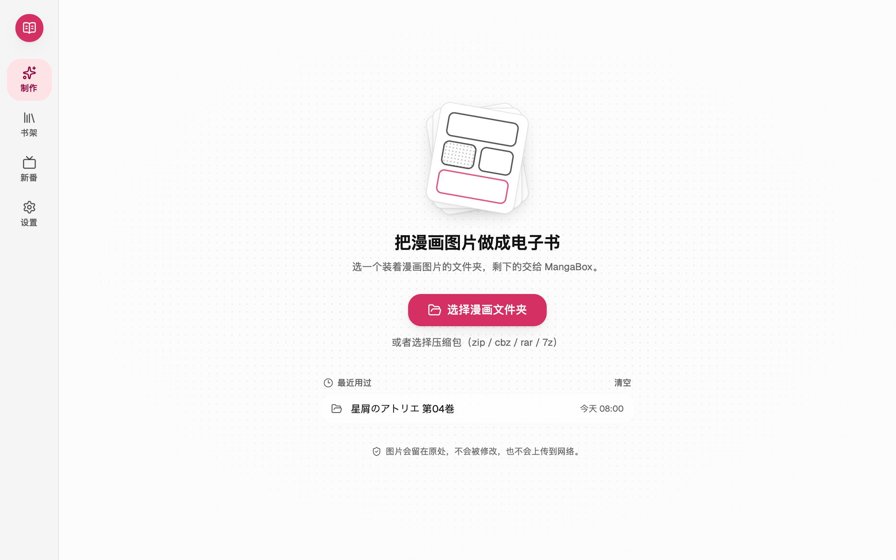 | 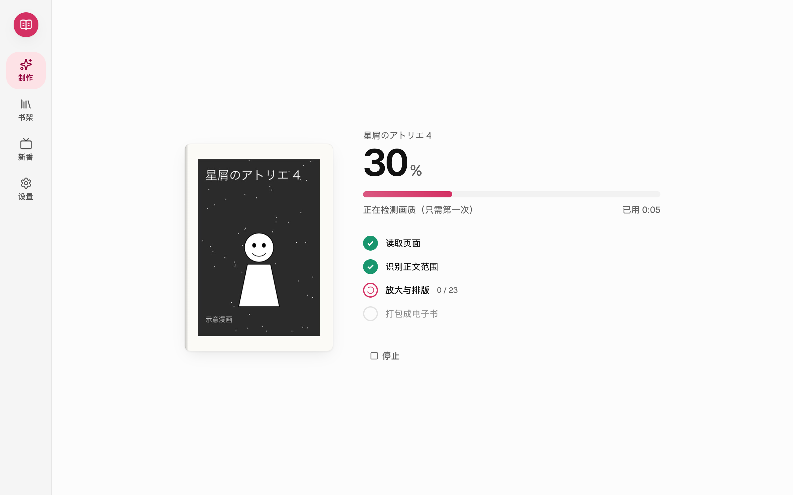 |
| **检查并修正** | **做书前后对比** |
| 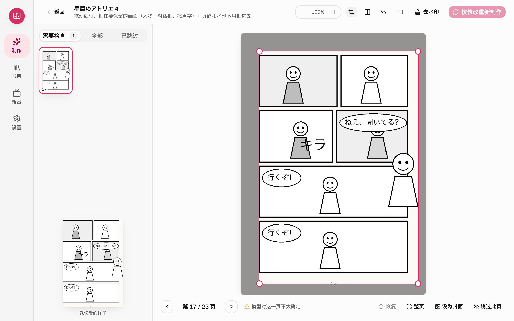 | 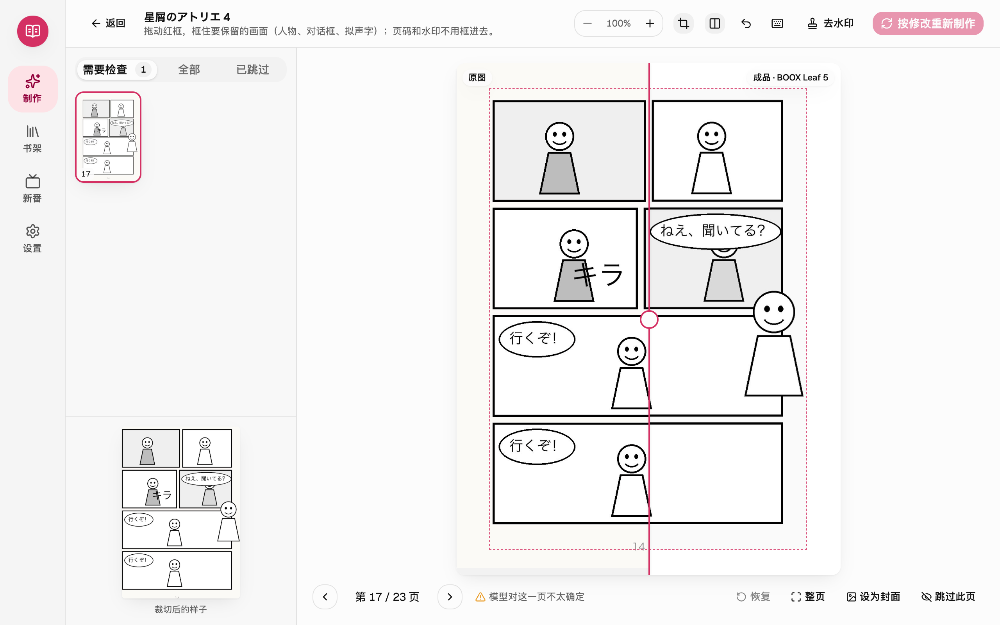 |
| **书架** | **作品主页** |
| 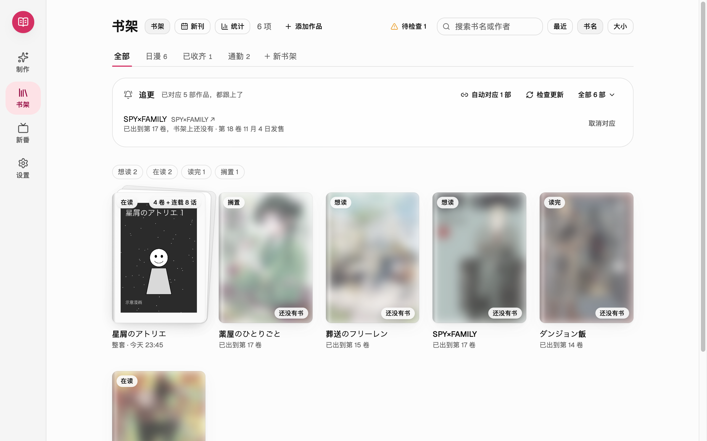 | 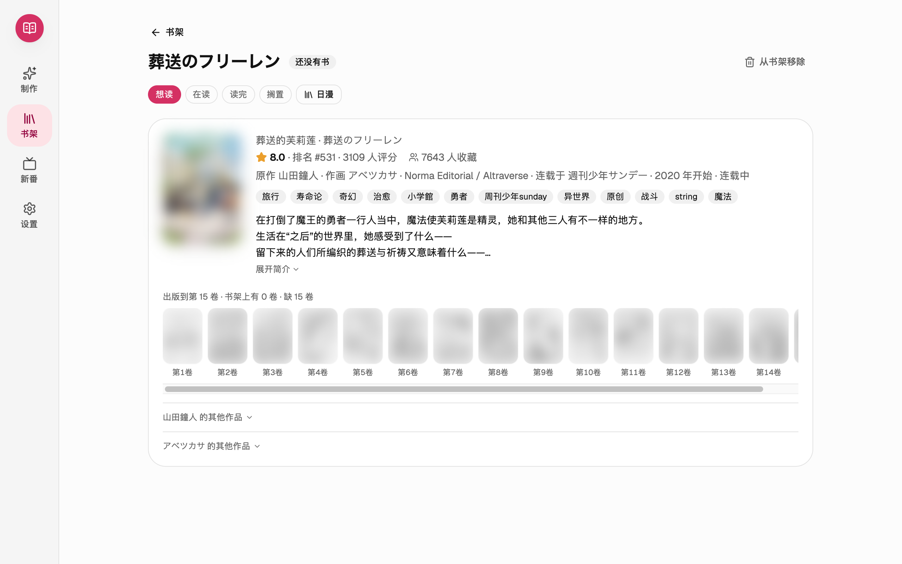 |
| **新刊日历** | **新番原作** |
| 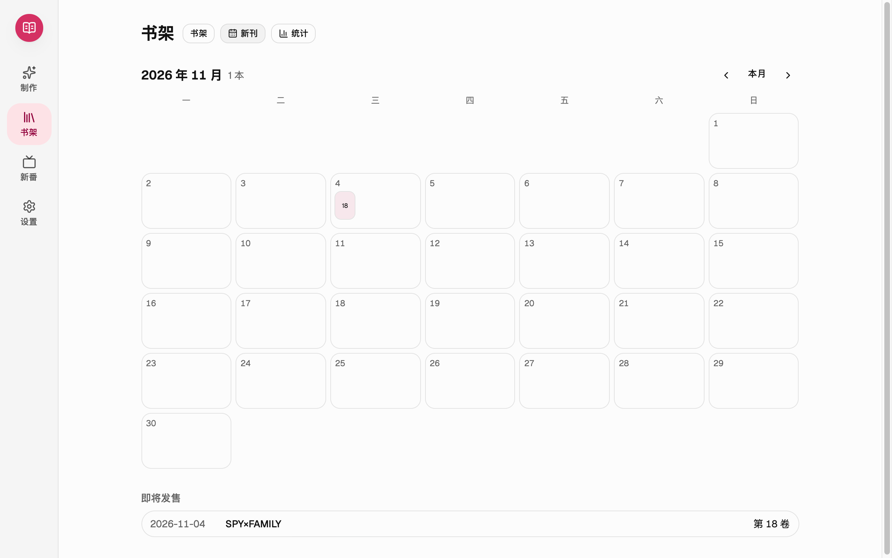 | 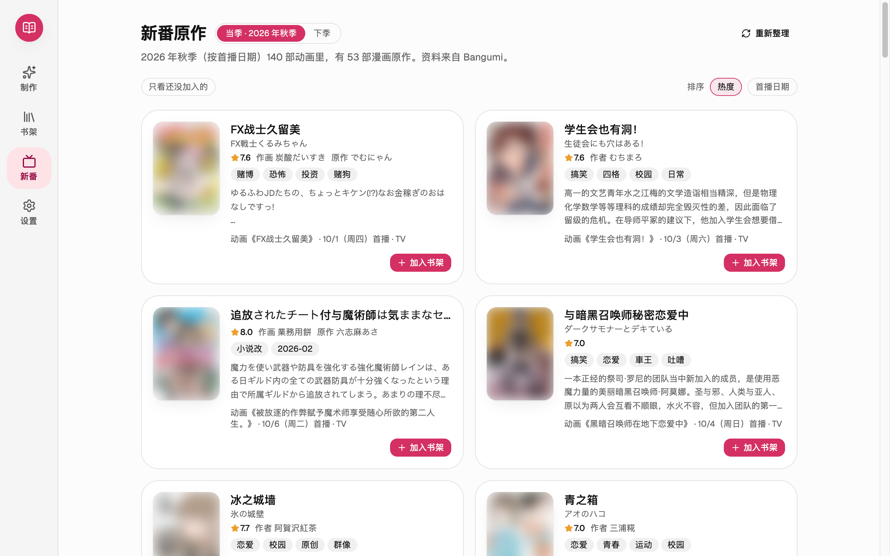 |
| **收藏统计** | **深色模式** |
| 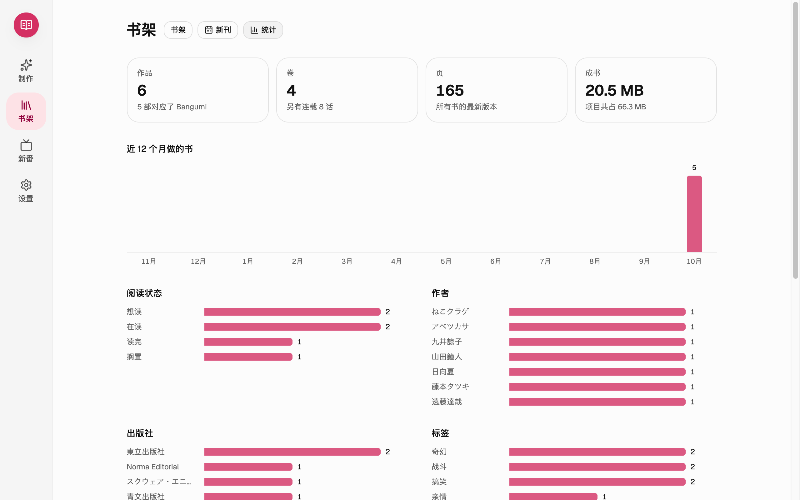 | 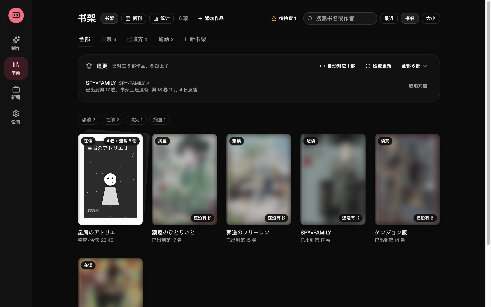 |

截图中“星屑のアトリエ”是程序生成的示意漫画；其他作品的资料来自 Bangumi，封面已模糊处理。

## 下载与安装

到 [Releases](https://github.com/x956606865/mangabox/releases/latest) 下载对应系统的安装包：

| 系统 | 文件 | 要求 |
| --- | --- | --- |
| macOS | `MangaBox-版本-macos-arm64.dmg` | Apple 芯片（M1 及更新），macOS 12 以上 |
| Windows | `MangaBox-版本-windows-x64.zip` | 64 位 Windows 10 / 11 |

### macOS 第一次打开

MangaBox 是免费软件，没有向苹果付费做“公证”，第一次打开时系统会提示无法验证开发者：

1. 打开 dmg，把 MangaBox 拖到“应用程序”。
2. 双击 MangaBox，看到提示后点“完成”。
3. 打开“系统设置 → 隐私与安全性”，在页面下方点“仍要打开”，输入密码确认。

以后就可以像普通软件一样直接打开。

### Windows

1. 右键 zip →“全部解压缩”（不要在压缩包里直接运行）。
2. 打开解压出的 MangaBox 文件夹，双击“启动 MangaBox.bat”。
3. 如果出现“Windows 已保护你的电脑”，点“更多信息”→“仍要运行”。

macOS 用 Apple 芯片加速；Windows 有显卡（NVIDIA / AMD / Intel）时自动用显卡加速，不需要另外下载，用不了时改用 CPU（慢一些，效果一样）。

## 常见问题

**会上传我的漫画吗？** 不会。所有处理都在你的电脑上完成，图片不会离开你的电脑。只在这些时候联网：检查新版本和下载模型（GitHub）；查找作者、追更、看作品主页和新番时向 Bangumi 查询资料（只发送作品名或条目编号）；以及你主动连接百度网盘、选择“上传到网盘”时，把你选的电子书上传到你自己网盘的“我的应用数据”文件夹。详见[隐私政策](https://mangabox.moukeer.com/privacy.html)。

**做好的书在哪里？** macOS 在“文稿/MangaBox”，Windows 在“文档\MangaBox”，也可以在“设置”里一键打开。

**支持压缩包吗？** 支持 zip / cbz / rar / 7z，可以直接选择或拖进窗口；有密码的压缩包需要先解压。

**怎么更新？** 有新版本时 MangaBox 会提示，在“设置 → 关于”点“更新并重启”，会自动下载、安装并重新打开（0.5.0 起）。

**遇到问题？** 请到 [Issues](https://github.com/x956606865/mangabox/issues/new/choose) 反馈，最好附上诊断信息：在“设置 → 遇到问题”点“导出诊断信息”，会在“下载”文件夹生成一个压缩包（不含漫画图片）。

## 隐私与条款

- [隐私政策](https://mangabox.moukeer.com/privacy.html)
- [服务条款](https://mangabox.moukeer.com/terms.html)

## 许可与致谢

MangaBox 免费提供，本仓库用于发布安装包和收集反馈。

随安装包附带的放大模型 [MangaJaNai / IllustrationJaNai](https://github.com/the-database/MangaJaNai)（作者 the-database）采用 **CC BY-NC 4.0**，只能用于非商业用途。其他开源组件的许可见安装包内的《第三方许可》。
